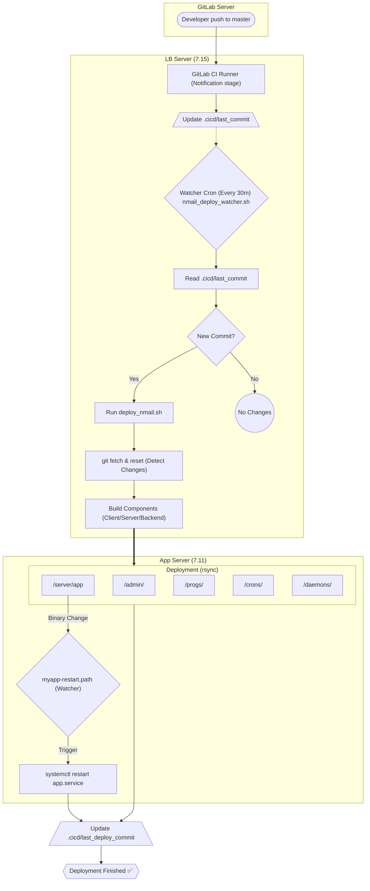

# Nmail CI/CD & Deployment Flow v2.0

Comprehensive documentation of the Nmail automated deployment pipeline, architectural components, and manual override procedures.

**Last Updated:** 2026-04-10
**Status:** Production (Offline-Ready Documentation)

---

## 1. Infrastructure Architecture

### 1.1 Hostname Reference
| Hostname | IP Address | Role |
| :--- | :--- | :--- |
| **lb.netcore.co.in** | 7.15 | Deployment Orchestrator, GitLab CI Runner Target, Build Host |
| **app.netcore.co.in** | 7.11 | Main Application Server, Deployment Target |

### 1.2 System Overview (Flowchart)


---

## 2. Deployment Timeline

1.  **Stage 1: Commit Notification (GitLab)**
    *   The `.gitlab-ci.yml` pipeline (notify stage) signals intent to deploy by updating `/opt/nmail/.cicd/last_commit`.
2.  **Stage 2: Change Detection (Watcher Cron)**
    *   `nmail_deploy_watcher.sh` runs every 30 minutes. It detects if the GitLab marker differs from the last deployed marker.
3.  **Stage 3: Code Synchronization**
    *   `deploy_nmail.sh` performs a hard reset to the master head.
4.  **Stage 4: Component Routing**
    *   The orchestrator uses `git diff` to identify modified directories (client, server, or backend) and triggers only the relevant build scripts.
5.  **Stage 5: Build & Sync**
    *   Compiles Go binaries, runs Node builds. Rsyncs artifacts to the App server (7.11).
6.  **Stage 6: Auto-Restart**
    *   `myapp-restart.path` watches the binary on the App server and triggers a `systemctl restart app.service` upon modification.

---

## 3. Key Files & Locations

### 3.1 Marker Files (7.15)
*   `/opt/nmail/.cicd/last_commit`: SHA of the latest commit intended for deployment.
*   `/opt/nmail/.cicd/last_deploy_commit`: SHA of the commit currently running in production.

### 3.2 Main Scripts (7.15)
- **Watcher:** `/opt/nmail/application/src/backend/crons/nmail_deploy_watcher.sh`
- **Orchestrator:** `/opt/nmail/application/src/backend/progs/deploy_nmail.sh`
- **Frontend Deployer:** `/opt/nmail/application/src/backend/progs/deploy_client.sh`
- **Go Server Deployer:** `/opt/nmail/application/src/backend/progs/deploy_server.sh`
- **Backend Components:** `/opt/nmail/application/src/backend/progs/deploy_backend.sh`

---

## 4. Service Configurations (7.11)

### 4.1 app.service
```ini
ExecStart=/opt/nmail/application/cgi-bin/server/./app
Restart=always
WorkingDirectory=/opt/nmail/application/src/
```

### 4.2 myapp-restart.path (Watcher)
```ini
[Path]
PathModified=/opt/nmail/application/cgi-bin/server/app
Unit=myapp-restart.service
```

---

## 5. Security & Permissions

| User / Service | Required Access | Reason |
| :--- | :--- | :--- |
| **gitlab-runner** | Write (last_commit) | Updating the SHA from GitLab CI pipeline. |
| **root** | Read/Write (Markers) | Running crons and orchestrator scripts. |
| **nmail-prod** | Read (Binary) | Monitoring the App server binary via systemd. |

---

## 6. Frequently Asked Questions (FAQ)

### 6.1 How can I force an immediate deployment?
Log into **lb.netcore.co.in (7.15)** as root and run:
`bash /opt/nmail/application/src/backend/progs/deploy_nmail.sh`

### 6.2 How do I rollback a broken deployment?
Revert the `master` branch in GitLab. The notification stage will update the commit marker, and the next watcher cycle will sync the previous stable state back to production.

### 6.3 What if the GitLab server is unreachable?
Manually edit `/opt/nmail/.cicd/last_commit` on the LB server and insert the desired commit SHA. The watcher will detect the manual change as a signal.

---
*Netcore Cloud | Internal NMail Documentation Platform*
